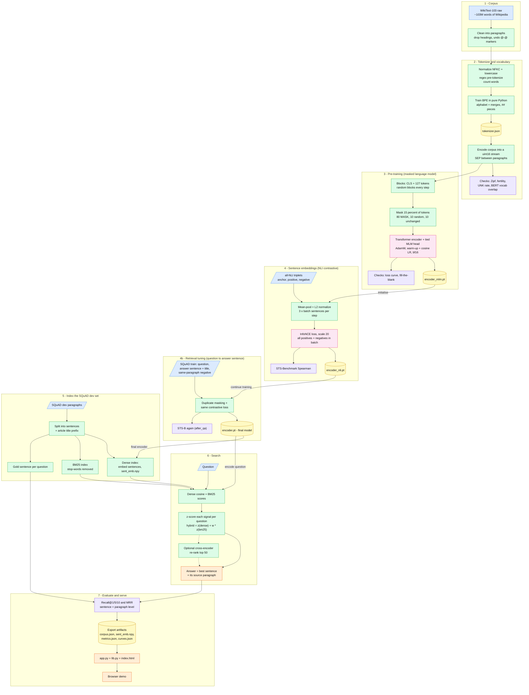
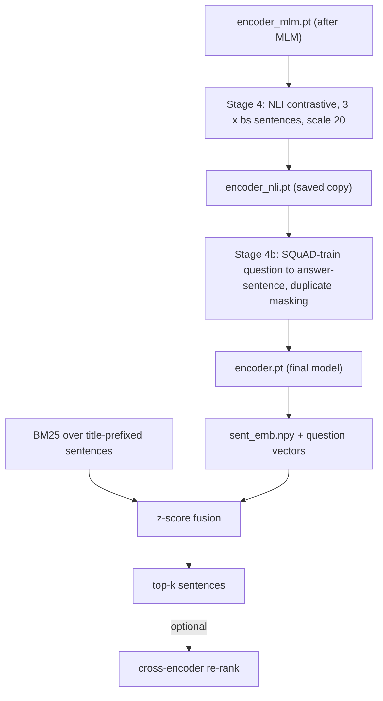
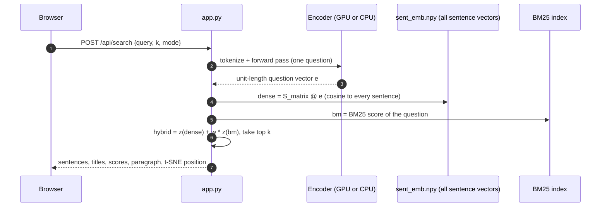

# Transformer Embeddings From Scratch — Semantic Search on SQuAD

**Notebook:** `transformer_embedding_from_scratch_improved.ipynb` ("improved v1")
**Idea in one line:** build every layer of a text-embedding system yourself — tokenizer, vocabulary, transformer, pre-training, contrastive fine-tuning, keyword search, hybrid ranking, evaluation and a web demo — and measure honestly how well it works.

*More diagrams in [section 3](#3-workflow-diagrams).*

---

## Workflow at a glance



Colours: blue = dataset, green = processing step, pink = model + training, yellow = file/artifact, purple = verification, orange = output/serving; dotted arrows = optional. `tokenizer.json` is used by every stage after stage 2.

<details>
<summary>Plain-text version (if your viewer does not render diagrams)</summary>

```text
1 CORPUS      WikiText-103 raw --> clean paragraphs (drop headings, undo @-@)
                   |
2 TOKENIZER        v
              normalize (NFKC + lowercase) --> regex pre-tokenize --> word counts
              --> train BPE (alphabet + merges, ## pieces) --> tokenizer.json
              --> encode corpus into a uint16 stream (SEP between paragraphs)
              --> checks: Zipf, fertility, UNK rate, BERT vocab overlap
                   |
3 PRE-TRAIN        v
              blocks of CLS + 127 tokens --> mask 15% (80 MASK / 10 random / 10 same)
              --> transformer encoder + tied MLM head --> encoder_mlm.pt
              --> checks: loss curve, fill-the-blank
                   |  (initialise)
4 NLI              v
              all-NLI triplets --> mean-pool + L2 normalize --> InfoNCE (scale 20)
              --> encoder_nli.pt   + STS-Benchmark Spearman
                   |  (continue training)
4b QA TUNING       v
              SQuAD train: question + answer sentence (with title) + same-paragraph negative
              --> duplicate masking + same contrastive loss --> encoder.pt (final)
              + STS-B again (after_qa)
                   |  (final encoder)
5 INDEX            v
              SQuAD dev --> sentences + title prefix --> dense index (sent_emb.npy)
                                                     --> BM25 index (stop-words removed)
                                                     --> gold sentence per question
                   |
6 SEARCH           v
              question --> dense cosine + BM25 --> z-score fusion: z(dense) + w * z(bm25)
              --> [optional cross-encoder re-rank of top 50] --> best sentence + paragraph
                   |
7 EVALUATE+SERVE   v
              Recall@1/5/10, MRR --> export artifacts --> app.py (+ lib.py, index.html) --> browser
```

</details>

---

## Table of contents

0. [Workflow at a glance](#workflow-at-a-glance) (diagram at the top of this file)
1. [What this project is](#1-what-this-project-is)
2. [What "improved" means: problems found and how they were fixed](#2-what-improved-means-problems-found-and-how-they-were-fixed)
3. [Workflow diagrams](#3-workflow-diagrams)
4. [Files and artifacts](#4-files-and-artifacts)
5. [Requirements and how to run](#5-requirements-and-how-to-run)
6. [Notebook walkthrough, section by section](#6-notebook-walkthrough-section-by-section)
7. [Evaluation: metrics and how to read them](#7-evaluation-metrics-and-how-to-read-them)
8. [Reference run (RTX 5080, `standard` preset)](#8-reference-run-rtx-5080-standard-preset)
9. [The demo app (`app.py`)](#9-the-demo-app-apppy)
10. [Hyperparameter reference](#10-hyperparameter-reference)
11. [Troubleshooting](#11-troubleshooting)
12. [Limitations and honest expectations](#12-limitations-and-honest-expectations)
13. [Glossary](#13-glossary)
14. [Datasets, models and references](#14-datasets-models-and-references)

---

## 1. What this project is

The notebook takes you from **raw Wikipedia text** to a **question → answer-sentence search engine**, writing the important parts by hand in PyTorch/NumPy:

| Stage | What is built | Data | How it is verified |
|---|---|---|---|
| 1 | Corpus cleaning | WikiText-103 (raw) | paragraph / word counts |
| 2 | **BPE tokenizer + vocabulary** (pure Python) | WikiText-103 | Zipf curve, fertility, [UNK] rate, overlap with BERT's vocabulary |
| 3 | **Transformer encoder** + **masked-language-model (MLM) pre-training** | WikiText-103 | loss curve, fill-in-the-blank examples |
| 4 | **Sentence embeddings** by contrastive learning | all-NLI triplets | **STS-Benchmark** Spearman correlation |
| 4b | **Retrieval fine-tuning** (question → answer sentence, hard negatives) | SQuAD v1.1 *train* | STS-B again, then retrieval metrics |
| 5 | **Semantic search**: dense + BM25 keyword search + hybrid fusion (+ optional re-ranker) | SQuAD v1.1 *dev* | Recall@k, MRR, versus a BM25 baseline |
| 6 | Export + **interactive web demo** | — | tokenizer / similarity / attention / search pages |

**What is "from scratch" and what is not**

| Built from scratch (random initialisation, trained here) | Pretrained pieces used (all optional, clearly separated) |
|---|---|
| BPE tokenizer and vocabulary | `bert-base-uncased` vocabulary — only to *compare* vocabularies (a printout) |
| Transformer encoder (all weights) | `cross-encoder/ms-marco-MiniLM-L-6-v2` — optional re-ranker (`USE_RERANKER = True`) |
| MLM pre-training, NLI and QA contrastive training | `all-MiniLM-L6-v2` — optional *reference point* in the scoreboard |
| BM25 (own implementation), hybrid fusion, metrics | |

The search is **extractive**: it returns the existing sentence most likely to contain the answer (plus its paragraph). Nothing is generated.

---

## 2. What "improved" means: problems found and how they were fixed

The first version returned wrong answers. For *"Which team won Super Bowl 50?"* the dense search returned five generic Super Bowl sentences that **all scored exactly 0.88**, and BM25 returned an unrelated 49ers/Stanford sentence first. Diagnosis and fixes:

| # | Problem observed | Cause | Fix (section / cell) |
|---|---|---|---|
| 1 | Dense model matched the *topic*, not the *answer* | Contrastive training used only NLI sentence pairs (same meaning), never question → answer pairs. Vocabulary gap such as *won* ↔ *defeated* was never learned | **New stage 4b:** train on SQuAD *train* (question, answer sentence, same-paragraph hard negative) — cell 29 |
| 2 | Every top result scored 0.88 | Embedding space was squashed (high cosine between unrelated sentences) | Stage 4b + a **diagnostic** that prints the mean cosine between random sentences (a healthy space is near 0; the first version's top-5 results all scored 0.88) — cell 32 |
| 3 | Sentences like "The Broncos took an early lead…" had no context | Short sentences lose the article they come from | Sentences are embedded **with their article title** (`"Super Bowl 50. The Broncos …"`), in training *and* at index time — cells 29, 31, 32 |
| 4 | BM25 ranked sentences matching "which", "team", "won", "Super Bowl 50" | No stop-word removal | `STOP` list; `bm_tokens()` — cell 32 |
| 5 | The hybrid was dominated by BM25 | Dense cosines live in a narrow band (e.g. 0.69–0.88) while BM25 was only divided by its max | **Per-question z-score** of both signals, then `z(dense) + w·z(bm25)`; `w` picked from {0.25, 0.5, 1, 2}; **RRF** reported as an alternative — cell 32 |
| 6 | No way to see whether training helped retrieval | Only the final table existed | Result table now includes `dense (NLI only, v1)` **before/after** row — cell 32 |
| 7 | Retrieval could still miss | Bi-encoder reads question and sentence separately | **Optional cross-encoder re-rank** of the top 50 (pretrained) — cell 35 |
| 8 | Crash for models whose `max_len` < 128 | Encoding limit was hard-coded to 128 | All encodes use `P["max_len"]` — cells 29, 32 |

---

## 3. Workflow diagrams

### 3.1 End-to-end pipeline

See **Workflow at a glance** at the top of this file (diagram plus a plain-text version). It follows the notebook stage by stage and shows which artifact feeds which step.

### 3.2 What happens to one piece of text (model forward path)


### 3.3 Training stages and how weights flow



### 3.4 What the demo does for one search request



### 3.5 Data shapes (standard preset, 128-token sequences)

| Step | Shape / unit |
|---|---|
| Token stream | one long `uint16` array; paragraphs separated by `[SEP]` |
| MLM batch | `(128 sequences, 128 tokens)` = `[CLS]` + 127 stream tokens |
| Contrastive batch | `3 × 128` sequences (anchors, positives, negatives), mean-pooled to `(384,)` vectors, L2-normalised |
| Similarity matrix in the loss | `(128 anchors) × (256 candidates)`; correct candidate for row *i* is column *i* |
| Index | `sent_emb.npy`: `(N_sentences, d)` `float16`; the standard run has `N = 10,420`, `d = 384` |

---

## 4. Files and artifacts

### 4.1 Project files

| File | Purpose |
|---|---|
| `transformer_embedding_from_scratch_improved.ipynb` | The whole pipeline (41 cells) |
| `app.py` | Dependency-light HTTP server for the demo (needs `torch`, `numpy`, `scipy`) |
| `lib.py` | Model/tokenizer code copied from the notebook, imported by `app.py` |
| `index.html` | The demo page (no external resources) |
| `artifacts/` | Everything the notebook exports (below) |

### 4.2 Files written to `artifacts/` (and zipped to `artifacts.zip`)

| File | Written in | Content |
|---|---|---|
| `tokenizer.json` | stage 2 | `vocab` (list of pieces) and `merges` |
| `encoder_mlm.pt` | stage 3 | `{"cfg": …, "state": state_dict}` after MLM only |
| `encoder_nli.pt` | start of stage 4b | encoder after the NLI stage (kept for the before/after comparison) |
| `encoder.pt` | stage 4, **overwritten** in 4b | final embedding model (same format) |
| `corpus.json` | export | `sentences`, `sent_para`, `para_title`, `paragraphs` of the SQuAD dev set |
| `sent_emb.npy` | export | `float16` matrix `(N_sentences, d)`, rows L2-normalised |
| `tsne_idx.npy`, `tsne_xy.npy` | export | indices and 2-D t-SNE coordinates of up to `tsne_n` sentences |
| `vocab_freq.json` | export | token frequency table (for the Zipf plot) |
| `curves.json` | export | `mlm`, `ft`, `sts_val`, `qa` loss/metric curves |
| `metrics.json` | export | everything measured (see 7.3) |

> **All files must come from one complete run.** `sent_emb.npy` only fits the `encoder.pt` that produced it, and `corpus.json` only fits that `sent_emb.npy`. `app.py` prints a warning when row counts or dimensions disagree.

---

## 5. Requirements and how to run

### 5.1 Software

* Python 3.10+ (the reference run used Python 3.13 and PyTorch 2.14 with CUDA 13).
* `pip install torch datasets tokenizers matplotlib scikit-learn scipy`
* Optional: `sentence-transformers` (re-ranker and MiniLM reference).
* **Internet** is needed for the Hugging Face datasets on first run: `Salesforce/wikitext`, `sentence-transformers/all-nli`, `sentence-transformers/stsb`, `rajpurkar/squad`.

### 5.2 Hardware

* A CUDA GPU is strongly recommended. bf16 is used on Ampere or newer (compute capability ≥ 8), fp16 + `GradScaler` otherwise (e.g. Colab T4), fp32 on CPU.
* If you get *CUDA out of memory*, lower `mlm_bs` / `ft_bs` in the preset.

### 5.3 Choosing a preset

The preset is read from the **environment variable `PRESET`** (default `quick`) in the config cell.

```bash
PRESET=standard jupyter lab            # or: export PRESET=standard before launching the notebook
```

| Preset | Purpose | Corpus | Model (`d` / layers / heads / FFN) | Vocab | MLM steps × batch | Notes |
|---|---|---|---|---|---|---|
| `smoke` | seconds; checks the code runs, numbers are meaningless | first 3,000 raw lines | 64 / 2 / 2 / 128, `max_len` 64 | 600 | 30 × 16 | uses `lr` 1e-3 everywhere |
| `quick` | whole pipeline in ~20–30 min | first 150,000 raw lines | 256 / 4 / 4 / 1024 | 8,000 | 4,000 × 128 | 3,000 dev questions |
| `standard` | better numbers (notebook says "a few hours" on modest GPUs) | all of WikiText-103 | 384 / 6 / 6 / 1536 | 16,000 | 30,000 × 128 | all ≈10.5k dev questions |

Measured on an **RTX 5080** (`standard`): MLM pre-training took **7.4 minutes** for 30,000 steps (≈ 1.1 million tokens/second).

Model sizes (encoder only, tied embeddings): `quick` ≈ 5.2 M parameters, `standard` ≈ 16.8 M (`encoder.pt` ≈ 67 MB in fp32).

### 5.4 Running

1. Open the notebook, set `PRESET`, **Run all** (top to bottom — later cells depend on earlier ones).
2. Watch the printed checkpoints (loss lines, STS-B, results table).
3. The last cell writes `artifacts/` and `artifacts.zip` (on Colab it also triggers a download).
4. Copy the **whole** `artifacts/` folder next to `app.py`, then see [section 9](#9-the-demo-app-apppy).

---

## 6. Notebook walkthrough, section by section

### Cell map

| Cells | Section |
|---|---|
| 0 | Title and overview table |
| 1–3 | Installs; config: presets, seeds, device, mixed precision, `METRICS`, `CURVES` |
| 4–5 | 1. Dataset: WikiText-103 |
| 6–11 | 2. Tokenizer and vocabulary (+ verification) |
| 12–13 | 3. Transformer encoder, MLM head, sanity checks |
| 14–16 | 4a. MLM pre-training, loss plot, fill-mask |
| 17–19 | 4b. Contrastive training on all-NLI |
| 20–21 | STS-Benchmark verification |
| 22–27 | 5. Sanity checks: neighbours, word groups, similarity matrix, attention |
| 28–29 | **5b. Retrieval fine-tuning on SQuAD train** |
| 30–33 | 6. Semantic search: data, BM25, dense, hybrid, metrics, `ask()` |
| 34–35 | Optional cross-encoder re-ranking |
| 36 | t-SNE map |
| 37–38 | Optional reference model (all-MiniLM-L6-v2) |
| 39–40 | 7. Export |

### 6.0 Setup (cells 1–3)

* Seeds: `SEED = 42` for Python, NumPy and PyTorch (GPU kernels can still be slightly non-deterministic).
* `BF16` is chosen from the GPU capability; `amp()` returns an `autocast` context; `GradScaler` is only enabled for fp16.
* `METRICS` and `CURVES` are dictionaries filled throughout the run and exported at the end.

### 6.1 Dataset (cells 4–5)

* `Salesforce/wikitext`, config `wikitext-103-raw-v1`, split `train` (~103 M words, curated Wikipedia). The *raw* version keeps casing and has no `<unk>` replacement.
* `clean_line` drops blank lines and `= Heading =` lines and undoes the markers `@-@`, `@,@`, `@.@`.
* `P["lines"]` slices the **raw** lines *before* cleaning, so `quick` (150,000) yields fewer paragraphs than that.

### 6.2 Tokenizer and vocabulary (cells 6–11)

**Normalisation and pre-tokenisation** — `NFKC` Unicode normalisation, lower-casing, then the regex `\w+|[^\w\s]` splits text into words and single punctuation marks.

**BPE training (`BPETokenizer.train`)**

1. Count characters (weighted by word frequency); the *alphabet* is every character with count ≥ `min_char`.
2. Keep words with count ≥ `min_word` whose characters are all in the alphabet.
3. Represent each word as pieces in BERT style: first piece bare, the rest with `##` (`play`, `##ing`).
4. Repeatedly merge the most frequent adjacent pair using a max-heap with lazy updates (stale entries are refreshed) until the vocabulary reaches `vocab_size`, no pair is left, or the best pair occurs fewer than 2 times.
5. Vocabulary layout: 5 special tokens (`[PAD] [UNK] [CLS] [SEP] [MASK]`) + alphabet + `##`-alphabet + merged pieces.

**Encoding** — merges are applied by rank; results are cached per word. If any piece is not in the vocabulary the **whole word becomes `[UNK]`** (like BERT). `encode(text, max_len)` adds `[CLS]`/`[SEP]` and truncates to `max_len − 2` real tokens. A literal `[MASK]` in text is kept as the mask token (used by `fill_mask`).

**Corpus encoding** — every paragraph is encoded and followed by `[SEP]`; everything is concatenated into one `uint16` array (`stream`). It also yields `freq` (token counts).

**Verification (cells 10–11)**

| Check | Meaning |
|---|---|
| Zipf plot | real language gives a near-straight line in log-log space |
| Fertility | tokens per word (BERT's WordPiece ≈ 1.2–1.4 on English) |
| `[UNK]` rate | should be tiny |
| Overlap with `bert-base-uncased` vocabulary and fertility on STS-B text | same `##` notation makes the comparison direct (skipped if offline) |

### 6.3 Transformer encoder (cells 12–13)

* **Pre-LayerNorm** transformer encoder: `tok_emb` + learned absolute `pos_emb` → LayerNorm → dropout (0.1) → `L ×` Block → final LayerNorm.
* **Block:** `x = x + dropout(Attn(LN(x)))`, then `x = x + dropout(FFN(LN(x)))`; `FFN = Linear(d, dff) → GELU → Linear(dff, d)`.
* **Attention:** one fused `qkv` projection, `h` heads, key-padding mask. Two code paths with identical maths: PyTorch's fused `scaled_dot_product_attention` (fast) and an explicit `softmax(QKᵀ/√d)V` path used when attention maps are requested (`return_attn=True`).
* **Initialisation:** normal(0, 0.02); residual-branch output projections shrunk by `1/√(2L)` (GPT-2 style).
* **MLM head** (`class MLM`): `Linear → GELU → LayerNorm`, then multiplication with the **tied** token-embedding matrix plus a bias; the loss is computed only at masked positions.
* **Sentence vector:** mean-pool over non-padding tokens, then L2-normalise (`mean_pool`, `pad_batch`).
* **Sanity checks printed:** fused vs explicit attention give the same output; padding does not change a sentence's embedding.

### 6.4 MLM pre-training (cells 14–16)

* **Data:** the token stream is cut into blocks of `max_len − 1` tokens; every training step samples `mlm_bs` random blocks (with replacement) and prepends `[CLS]`.
* **Masking (`mask_tokens`):** each non-special token is chosen with probability 15 %; of the chosen tokens 80 % → `[MASK]`, 10 % → random token, 10 % unchanged. Masks are re-drawn every step (*dynamic masking*).
* **Optimisation:** AdamW (β = 0.9, 0.98), weight decay 0.01 on matrices only, gradient clipping 1.0, learning-rate **warm-up 6 % (linear) then cosine decay to 10 % of the peak**, mixed precision.
* **Outputs:** `encoder_mlm.pt`, `CURVES["mlm"]`, `METRICS["mlm_final_loss"]`, `METRICS["mlm_minutes"]`.
* **`fill_mask`:** replaces one `[MASK]` and prints the top-5 tokens. Important: it is only meaningful **after** training has finished (a half-trained model has an un-annealed learning rate).

### 6.5 Sentence embeddings with NLI (cells 17–21)

* **Data:** `sentence-transformers/all-nli`, config `triplet`: *anchor*, *positive* (entailed), *negative* (contradicted). Each text is truncated to 64 tokens.
* **Batch:** `3 × ft_bs` sequences → mean-pool → L2-normalise → `anchors` and `candidates = positives + negatives`.
* **Loss (multiple-negatives ranking / InfoNCE):** `cross_entropy(anchors @ candidatesᵀ × 20, arange(bs))` — each anchor must rank its own positive above every other positive and every negative in the batch. The factor 20 is the *temperature scale*.
* **Schedule:** peak LR `1e-4` (1e-3 for `smoke`), same warm-up + cosine schedule; STS-B validation is measured about 10 times during training.
* **Verification (STS-Benchmark):** embed both sentences of each pair, take cosine similarity, report **Spearman correlation** with the human scores. Published references: averaged GloVe ≈ 0.58, SBERT-NLI-base ≈ 0.77. The notebook records `random_init`, `after_mlm`, `after_contrastive` (and later `after_qa`).
* **Output:** `encoder.pt`.

### 6.6 Do the embeddings look right? (cells 22–27)

* **Neighbours** of a word in the learned token-embedding table.
* **Word groups** (countries, colours, numbers, animals, months, family): mean cosine within vs across groups and a leave-one-out nearest-centroid accuracy, plus a PCA plot.
* **Similarity matrix** for eight example sentences (paraphrases should light up).
* **Attention heat-maps** for the last layer (up to 4 heads).

### 6.7 Stage 4b — retrieval fine-tuning on SQuAD train (cells 28–29)

Why: NLI teaches "same meaning"; search needs "this sentence **answers** that question".

* For each SQuAD *train* question: **positive** = the sentence containing `answer_start`; **hard negative** = one random *other* sentence from the **same paragraph**; both get the `"Article title. "` prefix. (SQuAD train and dev contain different articles, so there is no leakage into the evaluation.)
* Sentence splitting uses a regex on `.`, `!`, `?` followed by whitespace and an upper-case letter/digit/quote/bracket.
* **Duplicate masking:** every sentence gets an id; any in-batch candidate with the **same id as the positive** of another question is masked (set to −1e4) so identical sentences are never treated as negatives.
* Questions are truncated to `min(64, max_len)` tokens, sentences to `max_len`.
* Same loss/optimiser/schedule as stage 4, `qa_steps` steps (`quick` 1,500 / `standard` 4,000, `ft_bs` per batch, peak LR 1e-4).
* The NLI-only weights are saved as `encoder_nli.pt` first; afterwards `STS["after_qa"]` is measured and `encoder.pt` is overwritten.

### 6.8 Semantic search on SQuAD dev (cells 30–33)

* **Corpus:** every unique SQuAD *dev* paragraph is split into sentences (the standard run has **10,420** sentences) and each sentence is stored with its paragraph and article title.
* **Gold labels:** for each question the sentence containing `answer_start` (and its paragraph).
* **Dense index:** `sent_emb` = embeddings of `"title. sentence"`; `q_emb` = embeddings of the questions; score = cosine.
* **BM25 (own implementation, sparse matrices):** `idf = log(1 + (N − df + 0.5)/(df + 0.5))`, `k1 = 1.5`, `b = 0.75`; tokens come from `bm_tokens` (same pre-tokenizer as above minus stop-words).
* **Hybrid (z-score fusion):** `hybrid = z(dense) + w · z(bm25)` where `z` standardises each question's score vector (mean 0, std 1). `w` is chosen from `{0.25, 0.5, 1.0, 2.0}` by sentence-level MRR on the dev questions (one scalar tuned on the evaluation set — a mild optimism to keep in mind).
* **RRF variant:** `1/(60 + rank_dense) + 1/(60 + rank_bm25)`.
* **Metrics:** Recall@1/5/10 and MRR at **sentence** level and **paragraph** level (a paragraph's score is its best sentence's score).
* **Result table** keys in `METRICS["retrieval"]`: `dense (NLI only, v1)`, `dense (ours)`, `bm25`, `hybrid`, `hybrid (RRF)`.
* **`ask(question)`** prints the top-3 sentences with the same hybrid.
* **Mean-cosine diagnostic:** average cosine between 2,000 random sentences.

### 6.9 Optional re-ranker, map and reference (cells 34–38)

* **Cross-encoder re-rank (pretrained):** the top 50 hybrid candidates are re-scored with `cross-encoder/ms-marco-MiniLM-L-6-v2`; before/after metrics on the first 500 questions go to `METRICS["rerank_first500"]`. Wrapped in `try/except`, so it is skipped when the download or package is unavailable.
* **t-SNE map:** up to `tsne_n` sentence embeddings, coloured by article (used by the demo).
* **MiniLM reference:** runs the same evaluation code with `all-MiniLM-L6-v2` to show the ceiling for a strong pretrained small model (skipped if unavailable).

### 6.10 Export (cells 39–40)

Writes the files in [4.2](#42-files-written-to-artifacts-and-zipped-to-artifactszip) and zips them.

---

## 7. Evaluation: metrics and how to read them

### 7.1 Definitions

| Metric | Meaning |
|---|---|
| **Spearman (STS-B)** | rank correlation between cosine similarity and human similarity scores (0–1, higher is better) |
| **R@k (Recall@k)** | share of questions whose gold sentence/paragraph is among the top *k* results |
| **MRR** | mean of `1 / rank_of_gold` (1 = always first) |
| **MLM loss** | cross-entropy on masked tokens; `perplexity = exp(loss)`; random guess = `ln(vocab)` |
| **Fertility** | tokens per word (lower = fewer fragments) |
| **Mean random cosine** | embedding-space health check (should be near 0, not near 1) |

### 7.2 Print your own results table

```python
import json
m = json.load(open("artifacts/metrics.json"))
print("STS-B test:", {k: round(v["test"], 3) for k, v in m["sts"].items()})
for name, d in m["retrieval"].items():
    print(f"{name:<24}", {lv: {k: round(x, 3) for k, x in r.items()} for lv, r in d.items()})
print("BM25 weight:", m.get("bm25_weight"))
```

### 7.3 `metrics.json` keys

`preset`, `config`, `tokenizer` (`vocab_size`, `fertility`, `unk_rate`, `corpus_tokens`, optional `bert_overlap`, …), `mlm_final_loss`, `mlm_minutes`, `sts` (`random_init`, `after_mlm`, `after_contrastive`, `after_qa`, each with `validation` and `test`), `ft_minutes`, `qa_minutes`, `word_groups`, `retrieval`, `bm25_weight`, optional `rerank_first500` and `reference_all_MiniLM_L6_v2`.

### 7.4 What to expect

* A random network scores near 0 on STS-B; each stage should raise it.
* **BM25 is very strong on SQuAD** because questions reuse words from the answer sentence. A small from-scratch dense model usually trails BM25 on its own; the **hybrid** is typically better than either (that is the reason for fusing them).
* A cross-encoder re-ranker normally gives the largest single jump in R@1.

---

## 8. Reference run (RTX 5080, `standard` preset)

Facts reported from one real run (other numbers are in your own `metrics.json`):

| Item | Value |
|---|---|
| Software | Python 3.13.13, PyTorch 2.14.1 + CUDA 13, RTX 5080 |
| Vocabulary | 16,000 pieces |
| Model | `d = 384`, 6 layers, 6 heads, FFN 1,536 → ≈ 16.8 M parameters |
| MLM data | 912,615 sequences of 128 tokens (≈ 116 M tokens) |
| MLM training | 30,000 steps × 128 sequences ≈ 488 M tokens ≈ **4.2 passes**, **7.4 min** |
| MLM loss (train, with dropout) | 6.25 (step 3k) → 3.92 → 3.41 → 3.18 → 3.03 → 2.93 → 2.84 → 2.78 → 2.73 → **2.716** (perplexity ≈ 15) |
| Indexed sentences | 10,420 (`sent_emb.npy`: 10,420 × 384, rows unit-length) |
| Mean cosine between random sentences | **0.019** (healthy; in the first version the top-5 results all scored 0.88, a sign of a squashed space) |
| BM25 weight chosen by the sweep | 0.25 |

**Fill-the-blank samples from that run**

| Prompt | Top predictions |
|---|---|
| The capital of France is [MASK]. | unknown, now, destroyed, today, lost |
| He was born in [MASK] and died in 1990. | 1990, 1989, 1991, 1988, 1983 |
| The [MASK] won the football match. | club, team, match, referee, side |

How to read this: the model has learned grammar, word types and topical neighbourhoods (the football sentence is good; a year is predicted where a year belongs), but **not world knowledge or reasoning** (no "Paris"; it copies a nearby year instead of reasoning that a birth year precedes a death year). That is expected for a ~17 M-parameter model trained on ~116 M tokens — BERT-base has ~110 M parameters and saw on the order of 100× more text. For this project the *retrieval table* matters more than fill-the-blank quality, because stage 4b teaches the matching task directly.

---

## 9. The demo app (`app.py`)

### 9.1 Run

```bash
python app.py --artifacts artifacts            # then open  http://127.0.0.1:8000/test   and   http://127.0.0.1:8000/
python app.py --artifacts artifacts --port 8010 --no-browser
```

Options: `--artifacts DIR`, `--port N`, `--host H` (default `127.0.0.1`; `0.0.0.0` exposes the demo to the network), `--no-browser`.

**Remote or headless server (SSH):** `127.0.0.1` on the server is not your laptop. From **your laptop** run
`ssh -L 8000:127.0.0.1:8000 <user>@<server>` and keep it open, then browse to `http://127.0.0.1:8000/` locally (VS Code Remote: Ports tab → Forward a Port). `app.py` detects SSH/headless sessions and prints this hint.

### 9.2 Endpoints

| Route | Purpose |
|---|---|
| `GET /` | the demo page (`index.html`) |
| `GET /test` | tiny diagnostic page: calls `/ping`, `/debug`, `/api/info`, a search and `/`, showing timings |
| `GET /ping` | health check (`ok`) |
| `GET /debug` | JSON status: versions, device, uptime, in-flight requests, artifact sizes, recent log |
| `GET /slow?s=12` | fake slow request, to see the watchdog |
| `GET /api/info` | metrics, curves, Zipf data, t-SNE map (computed once at start-up) |
| `POST /api/tokenize` `{text}` | BPE pieces and ids |
| `POST /api/similarity` `{a, b}` | cosine + first 64 dimensions of each vector |
| `POST /api/neighbors` `{word}` | nearest tokens in the embedding table |
| `POST /api/attention` `{text, layer}` | attention matrices of every head |
| `POST /api/search` `{query, k, mode}` | `mode` = `dense`, `bm25` or `hybrid` |

### 9.3 Consistency with the notebook

* BM25 in `app.py` is a copy of the notebook's (stop-words, `k1`, `b`), built over the **title-prefixed** sentences.
* `hybrid = z(dense) + BM25_W · z(bm)` where `BM25_W` comes from `metrics.json["bm25_weight"]` (0.5 if missing).
* The cross-encoder re-ranker is **not** part of the app.

### 9.4 Built-in debugging

Every start-up stage prints a timestamp (imports, artifact sizes, each load, warm-up). If start-up stalls, a stack trace is printed every 20 s. After start-up the server calls itself over `127.0.0.1` and `localhost` (self-test). Each connection/request/response is logged with timing, and requests running longer than 8 s trigger a dump of all thread stacks.

---

## 10. Hyperparameter reference

### 10.1 From the presets

| Key | smoke | quick | standard | Meaning |
|---|---|---|---|---|
| `lines` | 3,000 | 150,000 | all | raw WikiText lines used (before cleaning) |
| `vocab_size` | 600 | 8,000 | 16,000 | BPE vocabulary size |
| `min_char` / `min_word` | 5 / 1 | 50 / 3 | 50 / 3 | alphabet / word frequency thresholds for BPE |
| `d_model` / `n_layers` / `n_heads` / `d_ff` | 64 / 2 / 2 / 128 | 256 / 4 / 4 / 1024 | 384 / 6 / 6 / 1536 | encoder size |
| `max_len` | 64 | 128 | 128 | sequence length / position table size |
| `mlm_steps` / `mlm_bs` / `lr` | 30 / 16 / 1e-3 | 4,000 / 128 / 8e-4 | 30,000 / 128 / 5e-4 | MLM pre-training |
| `nli_rows` / `ft_steps` / `ft_bs` | 600 / 20 / 16 | 100,000 / 800 / 128 | all / 4,300 / 128 | NLI contrastive stage |
| `qa_rows` / `qa_steps` | 400 / 20 | all / 1,500 | all / 4,000 | QA contrastive stage (batch = `ft_bs`) |
| `squad_q` | 100 | 3,000 | all | number of dev questions evaluated |
| `tsne_n` | 300 | 3,000 | 6,000 | sentences in the t-SNE map |

### 10.2 Fixed in the code

| Setting | Value |
|---|---|
| Dropout | 0.1 (embeddings, residual branches, attention) |
| MLM mask rate / split | 15 % / 80 % `[MASK]`, 10 % random, 10 % unchanged |
| Optimiser | AdamW, β = (0.9, 0.98), weight decay 0.01 on matrices (0 on biases and norms) |
| LR schedule | linear warm-up 6 %, cosine to 10 % of peak |
| Gradient clipping | 1.0 |
| Contrastive temperature scale | 20 |
| NLI text length | 64 tokens |
| Contrastive peak LR | 1e-4 (1e-3 in `smoke`) |
| BM25 | `k1 = 1.5`, `b = 0.75` |
| BM25 weight grid | {0.25, 0.5, 1.0, 2.0} |
| RRF constant | 60 |
| Re-ranker | top 50 candidates; evaluated on the first 500 questions |
| t-SNE | perplexity `min(30, n/4)`, PCA init, seed 0 |
| Seed | 42 |

---

## 11. Troubleshooting

| Symptom | Likely cause | What to do |
|---|---|---|
| `CUDA out of memory` | batch too large | lower `mlm_bs` / `ft_bs` |
| `IndexError` inside the embedding layer | text encoded longer than the model's `max_len` | use `max_len=P["max_len"]` in every encode (done in this notebook) |
| Web page "loads forever", terminal shows the server is listening | **browser is on a different machine** than the server (SSH) | use an SSH tunnel / VS Code port forwarding ([9.1](#91-run)) |
| Nothing printed for a long time at start | first `import torch` can take 10–60 s (cold disk, antivirus) | wait; the app prints each stage with timestamps |
| "Address already in use" / old page keeps answering | an older `app.py` still runs (on Windows two copies can silently share a port) | close old terminals or use `--port 8010` |
| Search results look wrong after copying artifacts | files from different runs mixed | copy **all** files from one run; look for the `WARNING … DIFFERENT runs` line |
| Fill-the-blank answers look poor | small model, or training was interrupted | check `mlm_final_loss`; see [section 12](#12-limitations-and-honest-expectations) |
| Reranker / BERT comparison / MiniLM cells print "skipped" | no internet or package missing | optional — everything else still works |
| Dataset download fails | Hugging Face not reachable | check internet / proxy; datasets are cached after the first success |

---

## 12. Limitations and honest expectations

* **Scale:** a 5–17 M-parameter model trained on ≤ 116 M tokens cannot rival pretrained models. The comparison with all-MiniLM-L6-v2 is there to show exactly that gap.
* **World knowledge:** fill-the-blank facts ("capital of France") need far more data and parameters. Retrieval quality is driven by stage 4b, not by MLM quality.
* **Evaluation set is small and specific:** ≈ 10.4 k sentences from 48 Wikipedia articles; BM25 is naturally strong there because questions copy words from the answer sentence.
* **Tuned on the evaluation set:** only one scalar (the BM25 weight) is chosen on dev questions, but it is still a slight optimism.
* **Titles are used as context:** SQuAD provides article titles; a real corpus may not.
* **Lower-casing and whole-word `[UNK]`:** accents/casing are normalised away; a word with an unseen character becomes `[UNK]`.
* **Brute-force search:** the dense search multiplies against all sentence vectors; for millions of documents use an approximate-nearest-neighbour index.
* **Extractive only:** the system returns sentences; it does not write answers.

**Ideas that were explored after v1 (not part of this notebook)** — a `large` preset (bigger model + extra Wikipedia articles) first produced *worse* fill-the-blank output. Candidate reasons, not yet confirmed: the run was stopped at 36,000/60,000 steps while the learning rate was still ~45 % of its peak; extra Wikipedia text can fill the vocabulary with rare-script characters (see the "single-character tokens" diagnostic in later versions); and whole-word masking was changed at the same time. Compare variants by the **retrieval table**, not by three hand-picked prompts, and change one thing at a time.

---

## 13. Glossary

| Term | Plain-language meaning |
|---|---|
| **Token / piece** | a chunk of text the model reads (`play`, `##ing`) |
| **BPE** | byte-pair encoding: build a vocabulary by repeatedly merging the most frequent neighbouring pieces |
| **Embedding** | a list of numbers (vector) that represents a token or sentence |
| **Transformer encoder** | a stack of attention + feed-forward layers that turns tokens into context-aware vectors |
| **Self-attention** | each token decides which other tokens to read from |
| **MLM** | masked language modelling: hide words, train the model to guess them |
| **Contrastive learning / InfoNCE** | pull matching pairs together and push others apart in vector space |
| **Hard negative** | a wrong answer that looks plausible (same paragraph) |
| **Cosine similarity** | angle-based similarity of two vectors (1 = same direction) |
| **STS-B** | sentence-similarity benchmark with human scores |
| **BM25** | classic keyword search that weighs rare words more |
| **z-score** | standardised value: (score − mean) / standard deviation |
| **RRF** | reciprocal-rank fusion: combine rankings by `1/(k + rank)` |
| **Cross-encoder** | model that reads question and passage together (accurate but slower) |
| **R@k, MRR** | retrieval quality metrics (see 7.1) |
| **t-SNE** | method to draw high-dimensional vectors on a 2-D map |
| **Fertility** | average number of pieces per word |

---

## 14. Datasets, models and references

* **WikiText-103** — Merity et al., 2016 (CC BY-SA). Hugging Face: `Salesforce/wikitext`.
* **all-NLI** (SNLI + MultiNLI triplets) — Hugging Face: `sentence-transformers/all-nli`.
* **STS-Benchmark** — Cer et al., 2017. Hugging Face: `sentence-transformers/stsb`.
* **SQuAD v1.1** — Rajpurkar et al., 2016 (CC BY-SA 4.0). Hugging Face: `rajpurkar/squad`.
* **BERT** — Devlin et al., 2018 (masked language modelling, WordPiece).
* **Sentence-BERT** — Reimers & Gurevych, 2019 (contrastive sentence embeddings; STS-B reference numbers).
* **BM25** — Robertson & Zaragoza, 2009. **Reciprocal rank fusion** — Cormack et al., 2009.
* Optional pretrained models: `cross-encoder/ms-marco-MiniLM-L-6-v2`, `sentence-transformers/all-MiniLM-L6-v2`.

Checkout https://embedding-k5s2.onrender.com for embedding results and a demo on my embedding modal
